# C4D MMD Tool

      

  

## About

mmdtool for Cinema 4D.

A plugin for Cinema 4D written in C++ is used to import MikuMikuDance data into Cinema 4D.

## Release

Click the latest version of the plugin under  to download it

Release filenames identify the plugin version, Cinema 4D compatibility and platform:

- **Windows x64**: `MMD-Tool-v<version>-Windows-x64-Setup.exe` — one installer for Cinema 4D R20 through 2026.
- **macOS Intel**: `MMD-Tool-v<version>-Cinema4D-2026-macOS-x86_64.zip` — choose the ZIP for your Cinema 4D version. Older pairs are labeled `R21-S22`, `R23-S24` and `R25-S26`; R20 has its own ZIP. Published macOS ZIPs contain Intel builds; Apple Silicon builds currently validate in CI only.

At present, the main maintenance version are R20 and higher, R19 and lower are unsupported.

If there is a problem with selecting multiple-parts when the model is imported, please do not check it.

**If the plugin is installed, please check whether the latest version of C4D is installed (such as R21 is R21.207, R21.115 does not show the upgrade can be used)**

## usage

1. Select the corresponding version of the plugin and place it in the plugins folder under the Cinema 4D installation directory.

2. Run Cinema 4D, find `MMDTool` in the menu -> Extension(Plugin) bar and click Run.

### Interface and features

The tool-panel screenshots below were captured in English Cinema 4D 2026.4.0 on 2026-10-13. Screenshots are cropped to the relevant controls. Scroll within each tab to reach the lower sections. Published releases may have a different interface.

#### Camera · VMD import, export and conversion

| Import and export | Camera conversion |
| --- | --- |
| 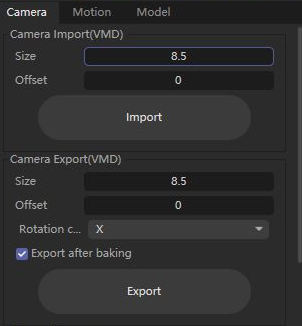 | 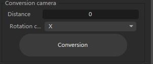 |

- **Import camera**: Load camera animation from a VMD file, with scale and start-frame offset settings.
- **Export camera**: Save camera animation as VMD, with scale, start-frame offset, rotation-curve and bake options.
- **Convert camera**: Convert a regular camera to an MMD camera, with distance and rotation-curve settings.

#### Motion and pose · VMD / VPD

| Motion import | Motion export and pose |
| --- | --- |
| 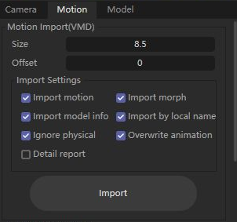 | 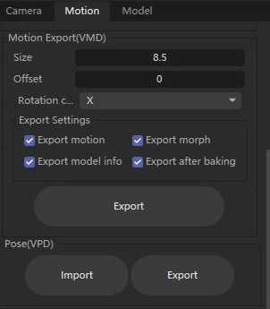 |

- **Import motion**: Load VMD bone animation, morph animation and model information onto a model, with scale and start-frame offset settings.
- **Import options**: Match local names, ignore physics bones, overwrite previous animation and show a detailed report. Model information includes IK switches and model visibility.
- **Export motion**: Save bone animation, morph animation and model information as VMD, with rotation-curve and bake options.
- **Pose**: Import a VPD pose, or export the selected MMD model's pose at the current frame as VPD.

#### Model · PMX import and export

| Model import | Model export |
| --- | --- |
| 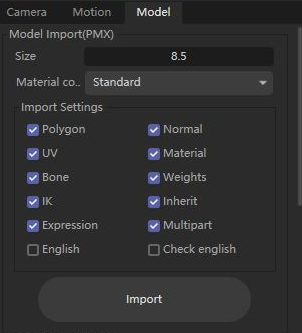 | 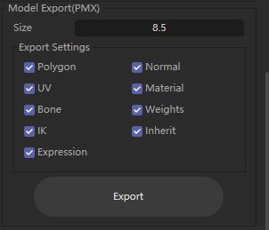 |

- **Import model**: Set the scale and choose which data to import: polygons, normals, UVs, materials, bones, weights, IK, inherit bones and morphs.
- **Material conversion**: Choose Standard, RedShift, Octane or Corona materials. The corresponding renderer must be available when required.
- **Import options**: Use separate meshes, English names and manual confirmation of English names.
- **Export model**: Save the selected MMD model as PMX, with scale and data-selection options. The source must be an MMD model managed by the plugin.

#### MMD model · Attribute Manager

Select the imported **MMD Model Manager** root in the Object Manager to open these pages in the Attribute Manager. Select the model root rather than a mesh, bone or bone tag. The standard Basic and Coordinates pages belong to Cinema 4D; the remaining pages belong to MMD Tool. Lists for materials, morphs, display frames and IK are populated from the selected model, so their contents vary between PMX files.

Screenshots were captured in English Cinema 4D 2026.4.0 on 2026-10-13. Model and material names are asset data and can remain Japanese or Chinese even when the interface is English. Some controls are unavailable until a valid list entry is selected.

Example model: **Sour式初音ミク Ver.1.02, Black.pmx**, by **Sour暄**. Model, material and morph names retain the original asset text. The model files are not distributed with this guide.

[1. Basic](#1-basic) · [2. Coordinates](#2-coordinates) · [3. MMD Model info](#3-mmd-model-info) · [4. Controllers](#4-controllers) · [5. Animation](#5-animation) · [6. Physics](#6-physics) · [7. Material](#7-material) · [8. Morph](#8-morph) · [9. Display Frame](#9-display-frame) · [10. IK](#10-ik) · [11. Material Morph](#11-material-morph)

##### 1. Basic

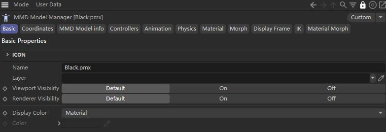

This standard C4D page contains the scene object's name, layer, editor/render visibility and display color. Renaming the scene object is separate from changing the Local / Universal model names stored in PMX. Use the visibility controls for the whole object hierarchy; the Controllers page filters controller outlines separately. Animated VMD model visibility can also influence the model during playback.

##### 2. Coordinates

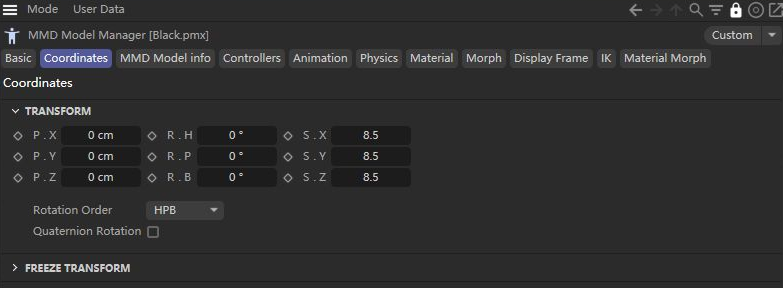

This standard C4D page sets the model root's position, rotation and scale in the scene. Move the root to place the whole character; use bones/controllers to pose its limbs. Root scale and **Position Multiple** serve different purposes: root scale is a scene transform, while Position Multiple is the MMD coordinate-conversion setting used with model/motion data. Keep model and VMD import scales consistent.

##### 3. MMD Model info

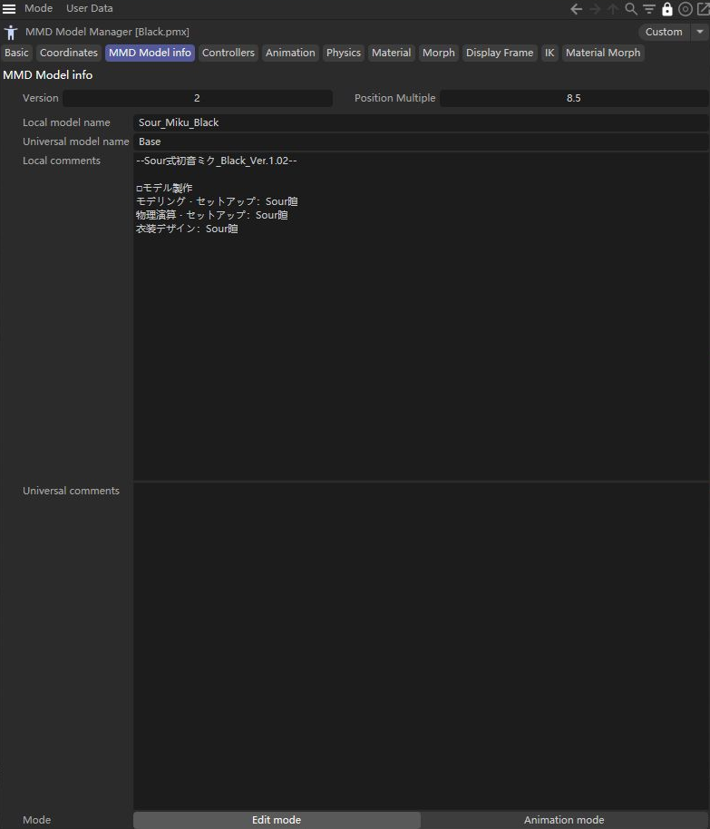

| Control | Meaning and use |
| --- | --- |
| Version | PMX format version, 2.0 or 2.1. Keep it consistent with the features required by the model. |
| Position Multiple | The model's MMD-to-C4D coordinate conversion scale, normally 8.5. Use the same scale when importing motion. This is not a substitute for resizing the model with the C4D Scale tool. |
| Local / Universal model name | The two model names stored in PMX. Universal is normally used for the English name. |
| Local / Universal comments | Model description, credits and usage conditions stored in PMX. Preserve the original author's notices when editing or exporting. |
| Edit mode | Edit the model's bind state and PMX data. Generated animation controllers are hidden. |
| Animation mode | Evaluate the selected animation, morphs, IK and enabled physics; show controllers according to their display settings. |

**Mode changes affect the bind state:** switching Edit → Animation commits the edited bind state. Switching Animation → Edit restores the bind state for editing. To change a pose, work in Animation mode and use the animation/controller controls; do not switch to Edit expecting the current animated pose to become the new rest pose.

##### 4. Controllers

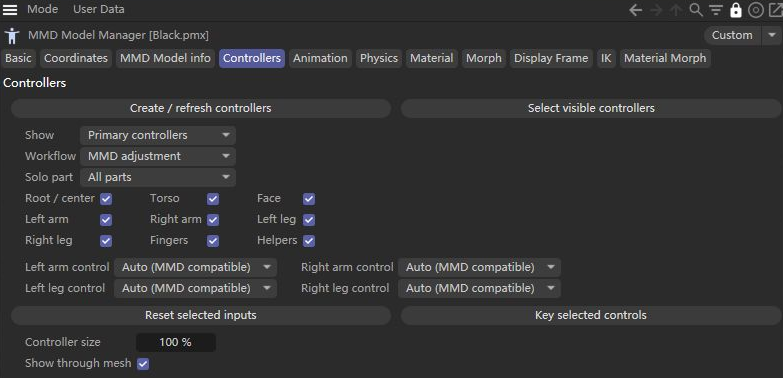

| Control | Meaning and use |
| --- | --- |
| Create / refresh controllers | Generate or refresh viewport controller outlines for the imported skeleton. Refresh retains existing controller transforms and animation tracks. |
| Select visible controllers | Select the controls allowed by the current display and part filters. |
| Show | Primary controllers, All controllers or Hide controllers. Edit mode hides generated controls regardless of this choice. |
| Workflow | MMD adjustment, IK animation, FK posing or Custom. Choose a starting workflow, then refine individual limb modes as needed. |
| Solo part / body groups | Isolate Root / center, Torso, Face, either arm or leg, or Fingers. Group checkboxes and Helpers refine visibility. These filters change which controls you see, not the PMX mesh's visibility. |
| Left / Right arm or leg control | Auto (MMD compatible), FK or IK. FK poses joint rotations; IK uses end goals and direction controls. Mode switching matches the current pose where the supported chain permits it. |
| Reset selected inputs | Reset selected controller inputs. Use Undo if you need to recover the previous adjustment. |
| Key selected controls | Key the selected generated controllers' inputs in C4D. This differs from registering the model state into its MMD animation slot. |
| Controller size / Show through mesh | Adjust outline size and whether controls remain visible through the mesh. Hovering a visible outline shows its bone name. |

For an imported VMD, start with **MMD adjustment**, show Primary controllers and isolate the body part you need. For a pose authored in C4D, choose an IK or FK workflow and key the controls. Available controls depend on the model's bone structure.

##### 5. Animation

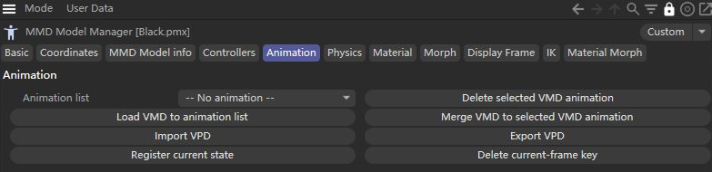

| Control | Meaning and use |
| --- | --- |
| Animation list | Choose the model's active VMD animation slot. Slots are alternatives; selecting one does not blend every imported motion together. |
| Load VMD to animation list | Import a VMD as another animation slot using the model's Position Multiple. Use the main Motion panel when you need detailed channel, offset or matching options. |
| Merge VMD to selected VMD animation | Merge file data into the selected slot. Select the destination slot first; this changes that slot. |
| Delete selected VMD animation | Remove the selected slot, rather than just disabling its playback. |
| Import / Export VPD | Import a static pose, or export the selected model's pose at the current time. VPD does not contain a full animation sequence. |
| Register current state | Register eligible changed bone inputs and morph strengths at the current MMD frame in the active animation workflow. Imported VPD poses can be registered this way. |
| Delete current-frame key | Remove keys at the current MMD frame from the selected slot, including bone, morph and model-information channels. This is broader than deleting a selected controller's C4D key. |

MMD animation uses a **30 fps frame basis**. A different C4D project frame rate changes the timeline's frame numbering, so confirm the corresponding time before registering or deleting keys. For VMD export, choose whether to bake in the main Motion panel and inspect the resulting motion.

##### 6. Physics

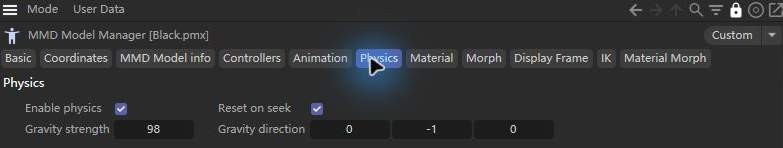

| Control | Meaning and use |
| --- | --- |
| Enable physics | Enable the model's MMD rigid-body and joint simulation. The model must contain suitable rigid bodies and joints. Disable it when comparing animation or IK without simulation. |
| Gravity strength | Set the gravity magnitude. |
| Gravity direction | Set the gravity vector's direction; downward is normally negative Y. |
| Reset on seek | Reset simulation state when seeking through time. Useful when scrubbing; jumping to a frame is not equivalent to simulating every preceding frame. |

For consistent inspection, return to the beginning and play forward. Physics results depend on elapsed simulation history; a single paused frame does not establish the quality of an entire animation.

##### 7. Material

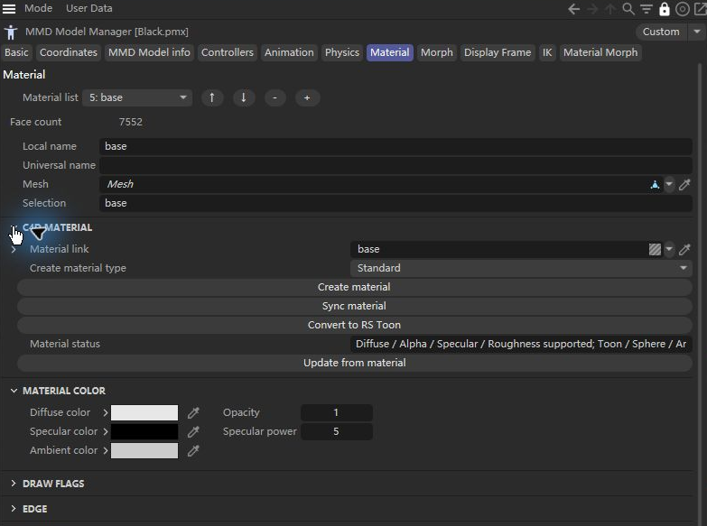

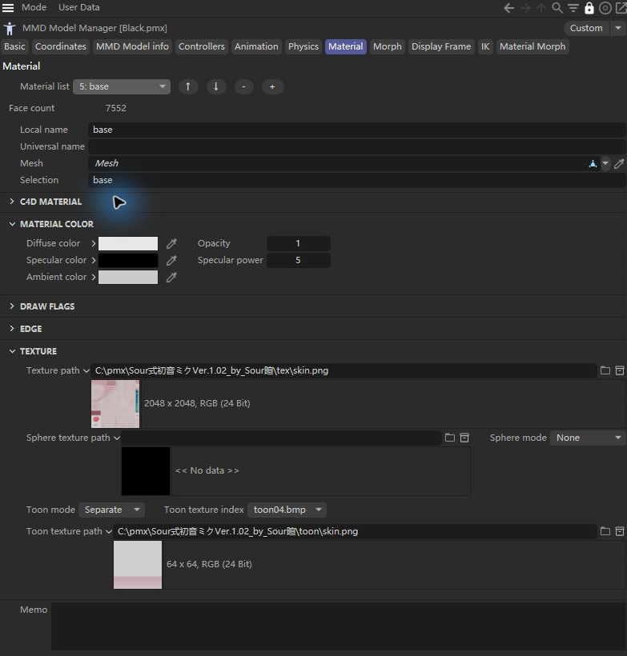

Select an entry in **Material list** before editing. These fields describe PMX material data and its connection to a C4D material.

| Area | Meaning and use |
| --- | --- |
| List, ↑ / ↓, − / + | Select, reorder, delete or add PMX material entries. Check mesh assignments and face ranges when changing the list. |
| Face count, names, Mesh, Selection | Inspect face allocation, local/universal names and the linked mesh/polygon selection used for the C4D assignment. |
| Material link | The corresponding C4D material. Verify this link when a material change does not appear on the intended mesh. |
| Create material type / Create material | Create a renderer material from the selected PMX entry: Standard, RedShift, Octane, Corona or RS Toon. Renderer availability and supported conversion paths depend on the installed renderer and C4D version. |
| Sync material | Send the stored MMD material fields to the linked C4D material. |
| Update from material | Read supported fields from an unmanaged C4D material back into PMX base data. Available in Edit mode with material preview disabled. Managed morph shader outputs have no separate base values to import. |
| Convert to RS Toon / Material status | Convert the selected assignment to the supported MMD-style Redshift Toon setup and inspect its status. Redshift is required. |
| Material Color | Diffuse color and opacity, specular color and power, and ambient color. |
| Draw Flags / Edge | PMX two-sided, shadow and vertex-color flags; outline enable, size, color and opacity. Stored PMX flags do not guarantee identical behavior in every C4D renderer. |
| Texture | Base texture path; sphere texture path and None / Multiply / Add / Sub texture mode; Separate or Common toon texture, including toon01–toon10. |
| Memo | The selected PMX material's notes. |

##### 8. Morph

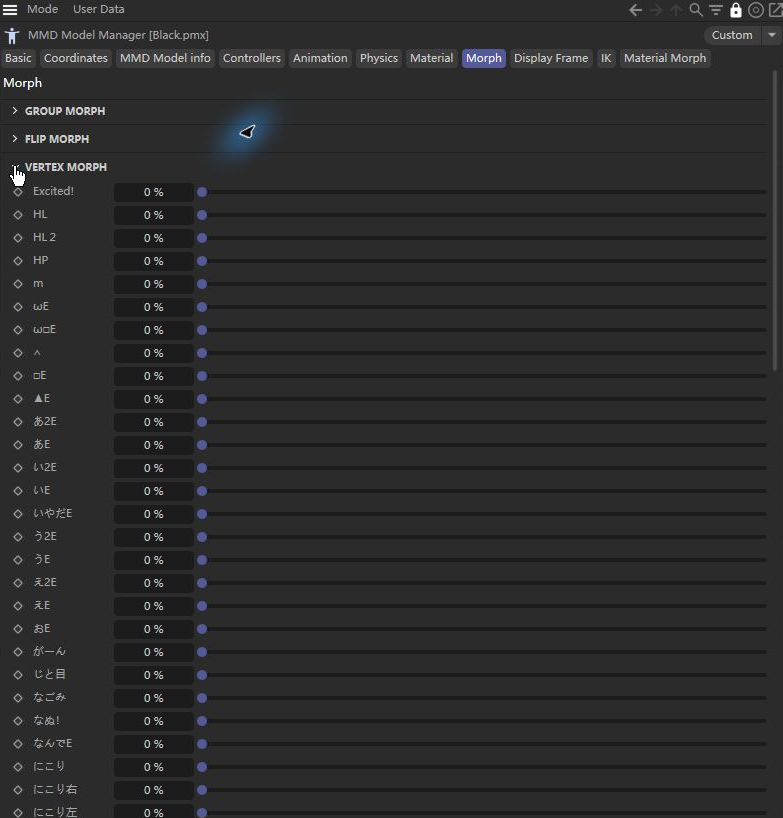

The **Morph** page exposes model-dependent strengths grouped by type: Group, Flip, Vertex, UV, Bone, Material and Impulse. Group and Flip morphs reference other morphs; vertex/UV/bone morphs modify their respective data; material morphs change material fields; impulse morphs affect physics bodies.

Use the strength sliders to pose or animate expressions. Imported VMD morph channels drive their corresponding strengths in Animation mode. The Add name / Add controls create Group, Flip, Material or Impulse entries; they do not automatically author a vertex or UV deformation. Expand an entry to edit the fields exposed for its type. To define a material morph's actual offsets, use the separate **Material Morph** page below.

##### 9. Display Frame

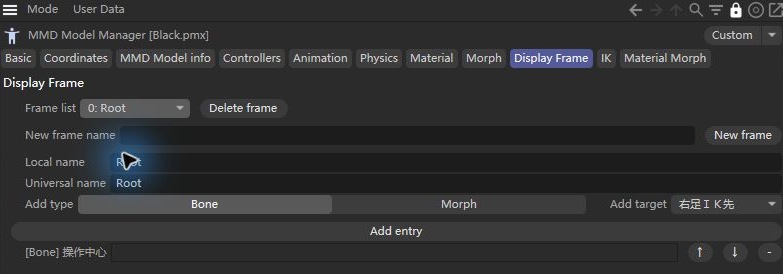

**Display Frame** means PMX bone/morph display groups, not timeline frames. Select a frame in Frame list or enter a New frame name and create one. Edit its Local / Universal name, choose Bone or Morph as Add type, select Add target and click Add entry. Existing entries can be edited or removed; Delete frame removes the selected group. These groups organize the model's PMX control lists and are retained for export; they do not key animation or hide geometry.

##### 10. IK

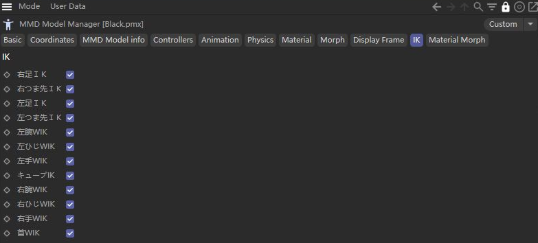

The **IK** page lists the solvers available in the imported skeleton. Each switch enables or disables its chain. VMD model-information channels can animate IK switches, so a setting can change with the selected slot or frame. If a foot or hand goal does not affect the pose, check this page, the limb's controller mode and the model's IK bone definitions. Disabling one chain is different from disabling physics for the whole model.

##### 11. Material Morph

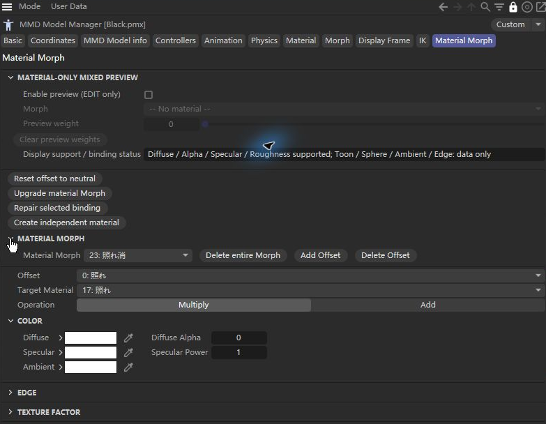

The **Morph** page controls strengths; **Material Morph** edits the data those strengths apply. Select a morph, then an offset, before changing its values.

| Control | Meaning and use |
| --- | --- |
| Material Morph / Delete entire Morph | Select a material morph or delete the complete entry. Complete deletion is available in Edit mode. |
| Add / Delete Offset, Offset | Manage the selected morph's individual material-change records. |
| Target Material | Select one PMX material or All Materials. |
| Operation | Multiply or Add. Neutral multiplier components are 1; neutral additive components are 0. Reset offset to neutral initializes the selected record accordingly. |
| Color / Edge / Texture Factor | Edit diffuse/alpha, specular/power, ambient, outline color/alpha/size and base/sphere/toon texture factors. A renderer may display only a subset; consult status. |
| Enable preview (EDIT only), Morph, Preview weight | Preview material effects in Edit mode without creating animation keys. Weights are retained separately for each selected preview morph, allowing a mixed preview. Group/Flip entries are offered only when suitable for material-only preview. |
| Clear preview weights | Clear the temporary mixed-preview weights. Entering Animation mode also clears this preview. |
| Upgrade material Morph | Prepare managed material bindings for the supported material-morph workflow in Edit mode. |
| Repair selected binding | Repair the selected material's managed binding in Edit mode. |
| Create independent material | Create an independent binding for the selected material in Edit mode, useful when a shared material would affect other models. |
| Display support / binding status | Check renderer support and binding diagnostics when an effect is missing or shared unexpectedly. |

PMX export stores the authored material and morph data. Preview support in a particular C4D renderer does not determine whether an offset is present in the PMX. Clear preview before updating base data from a C4D material, and test animated morphs in Animation mode after editing their offsets.

In this example, **23: 照れ消** targets **17: 照れ** with Multiply and Diffuse Alpha = 0. At full morph strength this removes that material's opacity; the multiplier is not the material's base opacity. To inspect it, enter Edit mode, enable preview, select the morph and raise Preview weight from 0 to 1. If the effect is unavailable, check the binding status and upgrade the material binding where supported. Clear preview weights before returning to ordinary editing.

#### VMD motion adaptation · Body proportions and stage previews

Adapt a VMD made for one character to another. Source and target PMX proportions drive movement correction, with optional stance, twist, arm avoidance, wrist/finger contact, floor contact and leg self-collision correction. Character queues and camera fitting are supported. The reusable C++ core lives in [libMMD](https://github.com/AiMiDi/libMMD) under `libmmd::sizing`, without a C4D SDK or Python runtime dependency.

1. Find **MMD Tools - VMD Motion Sizing** in the Extensions menu.
2. Select the **source PMX used to author the motion**, then drag an imported **target MMD model manager** from the scene into the model field.
3. Select a VMD file or an existing VMD animation slot on the target model. Use the same import scale for the model and motion; this example uses **8.5**.
4. Check scale and offset results first, then enable constraints as needed. Wrist/finger contact preserves the relative arrangement of nearby source hand landmarks; it does not generate grips or finger curls. Leg self-collision avoidance makes bounded adjustments to foot IK goals.
5. Calculate and watch progress in the C4D status bar; long operations can be cancelled. Select stages and scrub the timeline to compare original, scale, offset, stance, twist, avoidance and contact results. Side-by-side/overlay previews and automatic refresh after parameter changes are available.
6. Inspect residuals and important poses, then **apply as a new animation slot** or export VMD. The original slot is retained.

##### Panel controls and inputs

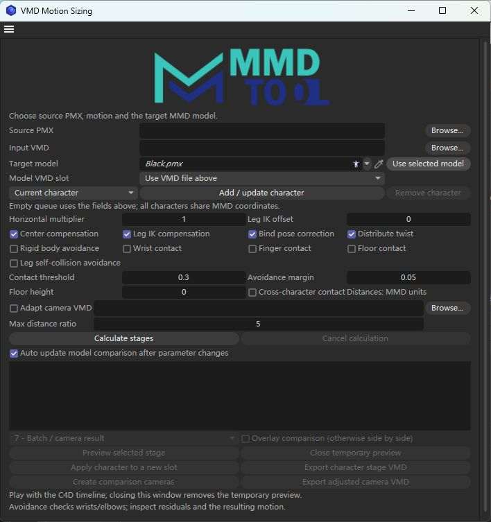

Captured in English Cinema 4D 2026.4.0 on 2026-10-13. The target is Sour式初音ミク Ver.1.02 (Black.pmx), by Sour暄. This screenshot shows input setup: source PMX and motion have not yet been selected, so stage previews and output actions are unavailable. The viewport comparisons below are separate, previously captured solver examples.

| Input / queue control | Meaning and use |
| --- | --- |
| Source PMX / Browse | Choose the model for which the motion was authored. Its bind skeleton provides the reference proportions; choosing the target PMX again does not describe the original character's proportions. |
| Input VMD / Model VMD slot | Use a VMD file, or select an imported slot on the target model. “Use VMD file above” selects the file input. Re-select the slot if its source slot was deleted. |
| Target model / Use selected model | Drag in the imported MMD model root, or select it in the original scene and click Use selected model. A mesh or an individual bone is not a model root. |
| Current character / Add / update character | An empty queue processes the current input. For multiple characters, set each target, source, motion and parameters, then add/update its queue entry. Choosing a queued character restores its settings. |
| Remove character | Remove the selected queue entry. A new draft does not participate until added. A batch supports up to 16 distinct targets in one document, using the same scale, MMD coordinate system and timeline. |

##### Scale and constraint settings

Start with the default scale/offset, bind-pose and twist settings. Inspect their results before adding constraints; enabling every option does not guarantee a better pose.

| Setting | Effect and practical use |
| --- | --- |
| Horizontal multiplier | Additional horizontal movement multiplier, default 1. Adjust travel after the source/target proportions have been analyzed; it does not resize the mesh. |
| Leg IK offset / Center compensation / Leg IK compensation | Adjust the additional leg-IK offset and enable center/foot-IK compensation. Inspect the scale and offset stages separately to locate unwanted displacement. |
| Bind pose correction | Compensate for supported source/target shoulder, arm and torso bind-axis differences. This does not change the target model's stored rest pose. |
| Distribute twist | Distribute rotation along supported twist-bone chains. Check wrist and elbow orientation after enabling it. |
| Rigid body avoidance / Avoidance margin | Use supported PMX rigid-body shapes to move wrist/elbow targets away from obstacles. The margin is a clearance parameter, not a mesh collision guarantee. |
| Wrist contact / Finger contact / Contact threshold | Preserve nearby source hand landmarks. The threshold controls which proximity relationships are considered; it is not a grip-strength setting. |
| Floor contact / Floor height | Correct supported hand/foot contacts relative to the specified ground plane. Set the ground height in MMD units and inspect stepping, crouching and airborne poses. |
| Leg self-collision avoidance | Make bounded foot-IK target adjustments for leg interference. Inspect knees and ankles; deep intersections can remain. |
| Cross-character contact | Include supported hand contacts across queued characters. It requires a shared MMD space and time basis. |
| Adapt camera VMD / Max distance ratio | Enable camera fitting, choose a camera VMD and cap its distance multiplier (default 5). Model motion input and camera motion input are separate files. |

Distance controls use **MMD units**, not the scaled C4D viewport units. The default contact threshold is 0.3, avoidance margin 0.05 and floor height 0; choose values for the actual source motion and target models.

##### Calculate, compare and output

| Control | Meaning and use |
| --- | --- |
| Calculate stages / Cancel calculation | Start the calculation or request cancellation. Read the status and diagnostics before using the result. Cancellation does not apply a new animation slot. |
| Auto update model comparison after parameter changes | Recalculate after parameter changes and refresh the temporary comparison. Disable it while entering several settings if you prefer to calculate manually. |
| Stage selector | Compare 0 Original, 1 Movement scale, 2 Center / IK offsets, 3 Bind pose correction, 4 Twist distribution, 5 Rigid body avoidance, 6 Contact correction and 7 Batch / camera result. An optional stage only contributes its enabled corrections. |
| Preview selected stage / Overlay comparison | Open the temporary before/after models. Blue is original motion, orange is the selected result; leave Overlay unchecked for side-by-side comparison. Scrub or play the C4D timeline, especially at contacts and transitions. Preview physics is disabled. |
| Diagnostics | Inspect warnings, maximum residual and unresolved constraints. A completed calculation can still contain unreachable or conflicting targets. |
| Close temporary preview | Close the comparison document. Closing the tool also removes its temporary preview; a preview is not an applied animation. |
| Apply character to a new slot | Add the selected character's result as a new slot on the source-scene model. The original motion is retained; applying supports Undo/Redo. Recalculate if the target bind model changed. |
| Export character stage VMD | Export the selected character and stage. Confirm both selectors before writing the file, particularly with a multi-character queue. |
| Create comparison cameras / Export adjusted camera VMD | Add the original/adjusted camera pair to the source scene, or write the adjusted camera motion to a VMD file. These actions require a valid camera result. |

Use standard MMD bone names and inspect warnings about missing references. The offline solver does not evaluate scene controller overrides, dynamic physics or external parents. Finish by checking important poses on the target model; motion adaptation can reduce manual work but does not eliminate it.

Enable camera adaptation and select a camera VMD to preview a **blue original camera** alongside an **orange adjusted camera**. Changing stages retains the currently viewed camera role. **Create comparison cameras** adds both cameras to the source scene as one undo step. The original camera uses the unmodified camera VMD for composition checks; side-by-side previews shift both camera groups with their respective characters. Object Manager icons use the same colors on C4D versions that support icon coloring.

Afu 2.0 with Stay Tonight Heaven Lee Ver., captured in the native C4D viewport with physics disabled.

**Legs and overall pose: the original, unadapted VMD on the left and the complete adaptation result on the right.** Both use the same import scale, animation frame and camera view.

**Wrist contact: the previous contact solver on the left and the correction that preserves the hand pose on the right.** This image shows the change in handling overlapping hands.

**Current limits:** Avoidance uses standard bone chains and rigid shapes. It does not guarantee mesh-level separation, full physics simulation or foot locking. Deep crossings and conflicting goals may still need manual adjustment; inspect important poses in the stage preview.

**Reference project:** Body-proportion and movement compensation adapts formulae from [miu200521358/vmd_sizing](https://github.com/miu200521358/vmd_sizing), revision `e5c30358696f688c96544e3af33ea9871961487d`. Its [MIT license and copyright notice](res/S24_up/licenses/vmd_sizing-MIT.txt) are retained. Advanced constraints are this project's C++ implementation; full feature or numerical equivalence with the Python tool is not claimed.

[Usage and solver limits](docs/dev/vmd-sizing.md) · [MCP interface](docs/dev/motion-sizing-mcp.md) · [Real-asset validation](docs/validation/vmd-sizing/leg-ik-fix-20261010/README.md)

## Developers

**Developer documentation:** [DEVELOPMENT.md](DEVELOPMENT.md) · [中文 DEVELOPMENT_zh.md](DEVELOPMENT_zh.md)

Windows development: `cmake --preset dev-windows` then `cmake --build --preset workflow-dev`. Release: configure `release-windows` then build `workflow-release`. Test preset `dev-windows-deps-test` supports `cmt-deps-test` and `cmt-plugin-tests`; benchmarks use the separate `cmt-deps-benchmark` target. PR/main CI compiles the latest SDK; releases build the complete SDK matrix. CI does not execute tests or benchmarks. Built plugin folders include copied, verified resources. See the developer guide for packaging and normal-start/attach debugging.

## Changelog

Recent version entries are shown below. See the [complete changelog](CHANGELOG.md) for earlier changes.

### 0.9.4 · Async physics enabled by default (2026-10-28)

Bullet physics solving now runs off the main thread and is **on by default**: the solver advances in a resident worker's own world while the main thread only submits bone world matrices and rigid-body identities each frame, then writes the returned transforms back to the scene behind an epoch plus identity check — any count or identity mismatch rejects the whole frame instead of writing wrong transforms. Six new modules (`cmt_physics_async`, `cmt_physics_pipeline`, `cmt_physics_epoch`, `cmt_physics_seed`, `cmt_physics_shadow`, `cmt_rigid_identity`) plus seven changed runtime and scheduling files. On a 625-bone / 479-rigid-body / 748-joint scene at 30 FPS, a frame drops from 37.75 ms to 20.53 ms and main-thread physics cost from 16.47 ms to 0.78 ms (15.69 ms saved per frame; A/B/A launches drifted 0.84%).

Semantics are validated per rigid-body class: solved dynamic bodies match the synchronous path one frame behind, bit for bit (36,160 comparisons, zero out of tolerance), while bone-following bodies match on the same frame (2,187 comparisons, zero out of tolerance). The first frame after a seek-driven world rebuild is reported separately because Bullet state is path dependent, and is excluded from the verdict. Three real defects were fixed along the way: a 4.34× trajectory divergence caused by building the shadow world at the wrong pose (it is now built at bind pose with corrected shadow-bone initial transforms, so `offsetMat` and joint anchors come from the same pose as the main world), an unprimed first-step bone velocity (`m_prevBoneOrigin`), and an identity parser that read the string parameter as an integer and froze all 479 rigid bodies.

Safety nets: fall back to synchronous physics when the worker throws, when eight consecutive submissions are rejected, or when the pipeline lags more than four frames; submission waits are capped at 500 ms, and Flush waits at most 500 ms with a diagnostic log. Undo, mode switches, rigid-body edits and bake paths shut down and rebuild the async pipeline; same-frame re-evaluation replays the most recent async result so control and morph edits still update physics poses immediately. No worker is started when the scene has no rigid bodies. Set `CMT_PHYSICS_ASYNC=0` to force synchronous physics.

Compatibility and validation: R20's legacy source processor does not accept the C++17 `namespace cmt::physics` shorthand, so those headers use classic nesting; a macOS Release unused-variable error on a diagnostic-only local is fixed. 30 of 31 plugin tests pass — the single failure, `cmt_motion_sizing_parallel`, hits its 60 s Debug timeout and passes in 62–63 s standalone. The full Windows and macOS SDK matrix is green at 29/29 CI jobs.

### 0.9.3.13 · macOS packaging fix (2026-10-25)

The v0.9.3.12 tag compiled on every SDK but still produced no release: the macOS packaging job never checked out the repository, so the profiling guard script (`cmake/check_profiling_disabled.cmake`) was missing from the empty workspace. Add the checkout step. The plugin binaries are unchanged from 0.9.3.12.

### 0.9.3.12 · macOS 2027 automation build fix (2026-10-25)

The v0.9.3.11 tag produced no packages: both macOS C4D 2027 jobs failed on the automation JSON bridge, which fed the sizing progress counters (`uint64_t`) into a `double` percentage implicitly — an error under the 2027 SDK's `-Wimplicit-int-float-conversion`. Convert explicitly; the reported percentage is unchanged. Release packaging runs in GitHub CI.

### 0.9.3.11 · macOS 2027 build fix (2026-10-24)

The v0.9.3.10 tag produced no packages: both macOS C4D 2027 jobs failed because the sizing progress bar mixed `uint64_t` counters into `double` implicitly, which clang in the 2027 SDK rejects as an error under `-Wimplicit-int-float-conversion`. Make the conversion explicit; the computed percentage and its rounding are unchanged.

The 0.9.3.10 legacy-SDK fixes are unaffected — every Windows job and the older macOS jobs compiled in that run. Release packaging runs in GitHub CI.
### 0.9.3.10 · Legacy SDK build matrix fixes (2026-10-24)

The v0.9.3.9 tag produced no packages: five legacy-SDK jobs failed to compile on Windows and two on macOS, so the release job never ran. The runtime changes themselves are unaffected.

Gate the update checker's HTTP flags behind the same SDK capability that gates its `maxon/network_url.h` include. The R21–2023 SDK trees kept in this repository do not configure `network.framework`, so that header is never generated; those versions now skip the HTTP update check instead of failing to compile, while R20 and 2024+ keep the existing behaviour. R20 also needs a non-const `BaseObject` to reach `GeListNode::GetDocument`.

Motion results, performance characteristics and the 0.9.3.9 changes are unchanged; release packaging runs in GitHub CI.
### 0.9.3.9 · Playback performance and standalone motion-sizing panel (2026-10-24)

Cut VMD playback cost without changing motion results: reuse controller data and material ownership, skip empty physics passes, drop duplicate weight notifications, and default to three physics substeps (90 Hz at 30 FPS). On the 625-bone scene the full-frame `ExecutePasses` dropped from 53.00 to 43.45 ms and Bullet from 23.06 to 13.77 ms with byte-identical output. The motion-adaptation flow now has its own command and panel, a measured compact joint-table candidate was archived as neutral, and release packages keep runtime profiling compiled out.

### 0.9.3.8 · Single-character parallel motion adaptation (2026-10-13)

Speed up independent twist, arm-avoidance and contact calculations with up to four workers by default, while retaining ordered temporal leg/floor corrections and identical motion results. Keep progress on the coordinator thread and release every worker safely on cancellation or failure. libMMD uses C++20 internally with C++17-compatible public headers; MCP exposes `worker_count` for serial comparison. Native comparisons cover Windows C4D 2026.4 at scene scale 8.5. Release CI can package a verified, source-compatible full Build run without compiling the same 21 SDK/platform jobs again.

### 0.9.3.6 · Constraint continuity and comparison cameras (2026-10-12)

Improve the release of floor corrections across frames and strengthen continuity guards for leg/contact adjustments. Fix computation-budget checks for batch contact participants. Add blue original and orange adjusted VMD cameras, preserve the current camera role across stages, and create or undo the pair together. Restore queued panel inputs on reopening, show deleted animation slots explicitly, and preserve manual edits against older MCP state. Also fix MCP field-type assertions and defer preview destruction until close/release calls return. Merged into main after Windows C4D 2026.4 native validation; GitHub CI produces the release packages.

### 0.9.3.5 · Motion adaptation fixes and controller workflow (2026-10-10)

Published as [v0.9.3.5](https://github.com/AiMiDi/C4D_MMD_Tool/releases/tag/v0.9.3.5) after joint native validation, release CI and package verification. [Validation record](docs/validation/vmd-sizing/joint-release-20261010/README.md).

1. Fix destructive wrist/finger contact adjustments while preserving finger curls, palm orientation and source contact relationships.
2. Reuse playback IK for offline poses, including PMX link limits, iteration counts and VMD IK switches; skip driven channels that cannot accept direct animation.
3. Add optional leg self-collision avoidance with foot IK target protection, temporal filtering and rollback for conflicting floor constraints.
4. Add C4D status-bar progress and cancellation feedback for long calculations, with shared MCP and panel options.
5. Document motion adaptation, wrist/leg effect comparisons and the reference project.
6. Fix false PMX binding expiry, uninitialized vertex data, QDEF weight IO and side effects in playback IK global-cache updates.
7. Add body groups, part isolation, arm IK, knee direction controls, matched FK/IK switching, controller keyframes and Undo.
8. Reduce widget sizes and fix model scale being applied twice to hand targets; preserve animation inputs when refreshing their display.
9. Stabilize small IK angles near parallel links to reduce knee-pose jumps caused by tiny input differences.

Inspect complex contacts in the stage preview. [Validation and known limits](docs/validation/vmd-sizing/leg-ik-fix-20261010/README.md)

### 0.9.3.3 · VMD motion adaptation (2026-10-10)

1. Add staged VMD motion adaptation with body-scale and movement offsets, stance and twist adjustment, rigid-shape avoidance, contact constraints, multi-character processing and camera fitting.
2. Add a localized C4D panel with scene-model selection, existing animation-slot input, before/after stage previews, queued characters and apply/export controls.
3. Add typed production MCP motion-sizing tools with asynchronous jobs, cancellation, preview, apply/export and shared panel state.
4. Move reusable calculation into libMMD under `libmmd::sizing`, independent of the C4D SDK, with public APIs, regression fixtures and documented solver limits.
5. Fix R20 source processing, R21 STL compatibility and pre-2026 LinkBox API support. Preserve SSE2 compilation for sizing to keep the validated numerical baseline.

### 0.9.3.2 · Controller placement and hover names (2026-10-09)

1. Fix eye controller placement on fresh PMX import; align the shared eye outline with the actual eye pair while retaining its authored rotation pivot and model scale.
2. Show the bone name when hovering a generated controller outline, using the selected local or English naming mode. Hidden controls and disabled spline display do not produce hints.
3. Remove direction triangles from rotation rings and ovals; retain shoulder leaders, hand wire boxes and toe IK triangles.
4. Hide generated controllers in Edit mode and restore Primary/All/Hidden settings in Animation mode. Preserve existing controller transforms and animation tracks when refreshing.
5. Avoid transient GitLab Eigen checkout failures in CI by using a mirror of the same pinned commit and bounded checkout retries.

[Changes since 0.9.3.0](https://github.com/AiMiDi/C4D_MMD_Tool/compare/v0.9.3.0...v0.9.3.2) · [Validation scope](https://github.com/AiMiDi/C4D_MMD_Tool/blob/32753932d529ce82677538d109d0709fec8be520/docs/dev/controllers-eye-hover-20261009.md)

## Author

AiMiDi

   

