# C4D MMD Tool

     

  

## 关于

Cinema 4D的mmdtool。

用C ++编写的Cinema 4D插件，用于将MikuMikuDance数据导入Cinema 4D。

## 发行版

插件点击  下的最新版本下载

发行文件名包含插件版本、适用的 Cinema 4D 版本和平台：

- **Windows x64**：`MMD-Tool-v<版本>-Windows-x64-Setup.exe`，一个安装包覆盖 Cinema 4D R20 至 2026，在安装向导中选择版本。
- **macOS Intel**：例如 `MMD-Tool-v<版本>-Cinema4D-2026-macOS-x86_64.zip`，按 Cinema 4D 版本选择 ZIP。旧版配对标为 `R21-S22`、`R23-S24`、`R25-S26`，R20 单独提供。当前发布的 macOS ZIP 为 Intel 构建，Apple Silicon 构建仅在 CI 中验证。

目前，主要维护版本为R20及更高版本，R19及以下版本未提供支持。

## 使用方法

1. 选择相应的插件版本，并将其放置在Cinema 4D安装目录下的plugins文件夹中。
2. 运行Cinema 4D，在菜单->扩展（插件）栏中找到 `MMDTool`，然后单击运行。

### 界面与功能展示

以下截图于 2026-10-06 在 Cinema 4D 2026.4.0 中实机截取，展示当前工作树插件的中文界面。截图仅保留对应的功能区域。各页可上下滚动；已发布版本的界面可能有所不同。

#### 摄像机 · VMD 导入、导出与转换

| 导入与导出 | 摄像机转换 |
| --- | --- |
| 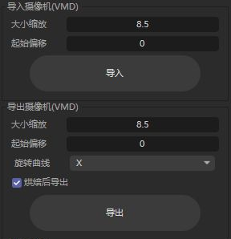 | 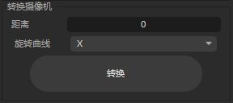 |

- **导入摄像机**：从 VMD 文件导入摄像机动画，可设置大小缩放和起始偏移。
- **导出摄像机**：将摄像机动画保存为 VMD，可设置大小缩放、起始偏移、旋转曲线与烘焙后导出。
- **转换摄像机**：将普通摄像机转换为 MMD 摄像机，可设置距离和旋转曲线。

#### 动作与姿势 · VMD / VPD

| 动作导入 | 动作导出与姿势 |
| --- | --- |
| 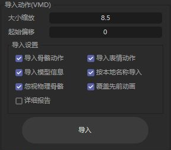 | 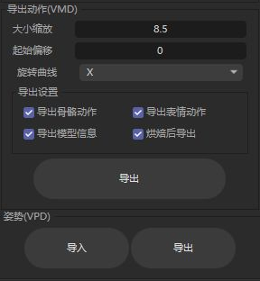 |

- **导入动作**：向模型导入 VMD 骨骼动作、表情动作和模型信息，可设置大小缩放与起始偏移。
- **导入选项**：按本地名称导入、忽视物理骨骼、覆盖先前动画，以及显示详细报告。模型信息包含 IK 开关和模型显示状态。
- **导出动作**：将模型的骨骼动作、表情动作和模型信息保存为 VMD，支持旋转曲线设置与烘焙后导出。
- **姿势**：导入 VPD 姿势，或将选中 MMD 模型当前时间点的姿势导出为 VPD。

#### 模型 · PMX 导入与导出

| 模型导入 | 模型导出 |
| --- | --- |
| 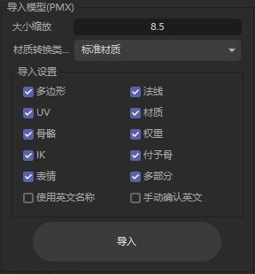 | 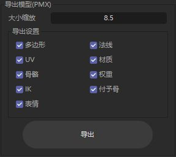 |

- **导入模型**：设置大小缩放，选择多边形、法线、UV、材质、骨骼、权重、IK、付予骨和表情等数据。
- **材质转换类型**：可选择标准材质、RedShift、Octane 或 Corona；使用相应渲染器时需具备对应环境。
- **导入选项**：支持多部分网格、使用英文名称和手动确认英文名称。
- **导出模型**：将选中的 MMD 模型保存为 PMX，可设置大小缩放并选择导出的数据。导出对象需为插件管理的 MMD 模型。

#### MMD 模型 · 属性管理器

在对象管理器中选中导入模型的根对象 **MMD 模型管理器**，即可在属性管理器中查看以下页面。应选模型根对象，而不是网格、单根骨骼或骨骼标签。常规的“基本”“坐标”页属于 Cinema 4D；其余标签页由插件提供。材质、表情、表示框和 IK 列表按当前 PMX 的内容生成，不同模型的项目数量和名称会不同；部分控件需先选中有效列表项才能使用。

本文界面截图于 2026-10-13 在 Cinema 4D 2026.4.0 中采集。中英文界面的字段含义相同；模型、骨骼和材质名称来自资源本身，不会因为切换 C4D 语言而自动翻译。

演示模型：**Sour式初音ミク Ver.1.02，Black.pmx**，作者 **Sour暄**。截图中的模型名称和材质／表情名称保留资源原文，模型文件不随本文分发。

[1. 基本](#1-基本) · [2. 坐标](#2-坐标) · [3. MMD 模型信息](#3-mmd-模型信息) · [4. 控制器](#4-控制器) · [5. 动画](#5-动画) · [6. 物理](#6-物理) · [7. 材质](#7-材质) · [8. 表情](#8-表情) · [9. 表示框（Display Frame）](#9-表示框display-frame) · [10. IK](#10-ik) · [11. 材质表情](#11-材质表情)

##### 1. 基本

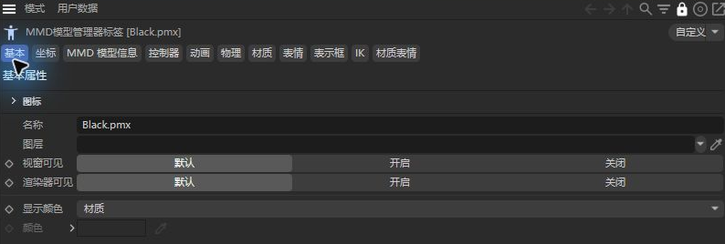

这是 C4D 标准页面，包含场景对象名称、图层、编辑器／渲染可见性及显示颜色。修改场景对象名称与修改 PMX 的本地／通用模型名称是两项操作。可见性用于整个对象层级；控制器线框的显示范围在“控制器”页调整。播放时 VMD 模型显示通道也可能影响模型可见性。

##### 2. 坐标

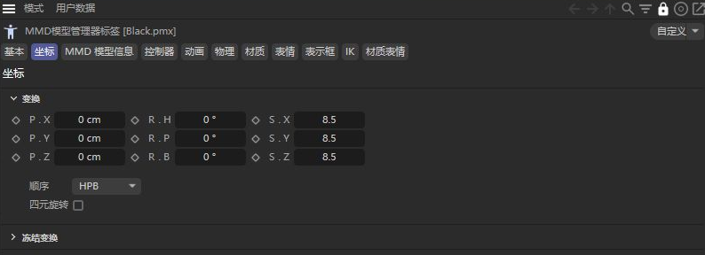

这是 C4D 标准页面，用于模型根对象在场景中的位置、旋转和缩放。移动根对象可放置整个角色，四肢摆姿则使用骨骼／控制器。根对象缩放属于场景变换，“位置倍率”用于 MMD 模型／动作数据的坐标换算，两者用途不同；模型和 VMD 导入仍须保持倍率一致。

##### 3. MMD 模型信息

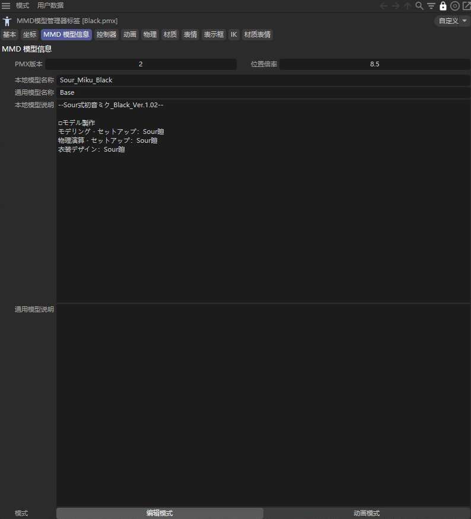

| 控件 | 含义与用法 |
| --- | --- |
| PMX 版本 | 模型使用的 PMX 格式版本，2.0 或 2.1。应与模型所需特性相符。 |
| 位置倍率 | MMD 与 C4D 坐标之间的换算倍率，通常为 8.5。导入动作应使用同一倍率；这个字段不能代替 C4D 的缩放工具来调整模型大小。 |
| 本地／通用模型名称 | PMX 保存的两套模型名称，“通用”通常填写英文名。 |
| 本地／通用模型说明 | PMX 保存的模型介绍、作者署名与使用条件。编辑和导出时请保留原作者说明。 |
| 编辑模式 | 编辑模型的绑定状态及 PMX 数据，生成的动画控制器隐藏。 |
| 动画模式 | 求值当前动画槽、表情、IK 和已启用的物理，按显示设置展示控制器。 |

**模式切换会处理绑定状态**：编辑 → 动画会提交编辑后的绑定状态；动画 → 编辑会恢复绑定状态供编辑。调整动作姿势时应使用动画模式及动画／控制器功能，不要通过切回编辑模式把当前播放姿势当作新的绑定姿势。

##### 4. 控制器

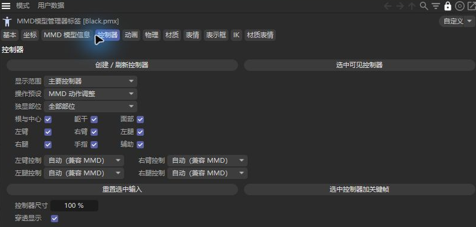

| 控件 | 含义与用法 |
| --- | --- |
| 创建／刷新控制器 | 为导入的骨架生成或刷新视口线框控制器，刷新会保留已有控制器变换和动画轨道。 |
| 选中可见控制器 | 选择当前显示范围与部位过滤允许显示的控制器。 |
| 显示范围 | 主要控制器、全部控制器或隐藏控制器。编辑模式会隐藏生成控制器。 |
| 操作预设 | MMD 调整、IK 动画、FK 摆姿或自定义。先选工作流，再按需要调整单独的四肢模式。 |
| 独显部位／身体分组 | 可独显根／中心、躯干、面部、左右手臂、左右腿或手指，并用分组勾选和辅助项细调。这里控制的是控制器显示，不是 PMX 网格可见性。 |
| 左右手臂／腿部控制 | 自动（兼容 MMD）、FK 或 IK。FK 调整关节旋转；IK 使用末端目标与方向控制。受支持的骨链切换模式时会匹配当前姿势。 |
| 重置选中输入 | 重置所选控制器的输入；需要恢复原调整时使用撤销。 |
| 选中控制器加关键帧 | 在 C4D 中为所选生成控制器的输入打关键帧，与向 MMD 动画槽“注册当前状态”用途不同。 |
| 控制器尺寸／穿透显示 | 调整线框大小及是否透过网格显示。鼠标悬停可见线框时显示对应骨骼名。 |

调整已有 VMD 时，可从 **MMD 调整 + 主要控制器** 开始，再独显所需部位。自行制作姿势或动画时，可选择 IK／FK 工作流并为控制器打帧。可用控制器取决于模型的骨骼结构。

##### 5. 动画

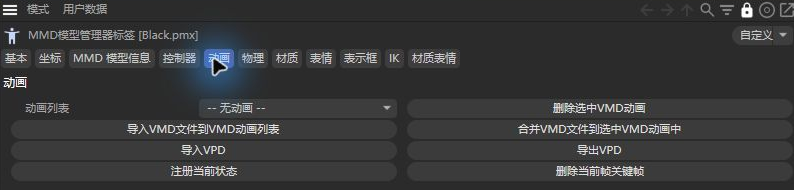

| 控件 | 含义与用法 |
| --- | --- |
| 动画列表 | 选择模型当前播放的 VMD 动画槽。多个槽用于切换动作，选择一个槽不会把所有已导入动作一起混合。 |
| 导入 VMD 文件到 VMD 动画列表 | 使用模型的位置倍率导入另一个 VMD 动画槽。需要细调通道、偏移和名称匹配时，使用主工具面板的动作页。 |
| 合并 VMD 文件到选中 VMD 动画中 | 将文件数据合并到选中槽。先确认目标槽；操作会修改该槽。 |
| 删除选中 VMD 动画 | 删除所选槽，而不是仅暂停该动作。 |
| 导入／导出 VPD | 导入静态姿势，或导出当前时间的模型姿势；VPD 不保存完整动画序列。 |
| 注册当前状态 | 在当前 MMD 帧将可注册的已修改骨骼输入和表情强度写入当前动画工作流；导入的 VPD 姿势也可通过此操作注册。 |
| 删除当前帧关键帧 | 删除选中槽在当前 MMD 帧的骨骼、表情及模型信息关键帧，范围大于删除单个控制器的 C4D 关键帧。 |

MMD 动画以 **30 fps** 为帧基准。C4D 工程使用其他帧率时，时间轴的帧编号会不同，注册或删除前应核对对应时间。导出 VMD 时在主动作面板选择是否烘焙，并检查导出结果。

##### 6. 物理

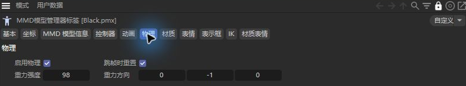

| 控件 | 含义与用法 |
| --- | --- |
| 启用物理 | 启用模型的 MMD 刚体与关节模拟，需要模型具有对应数据。单独比较动作或 IK 时可关闭。 |
| 重力强度 | 设置重力大小。 |
| 重力方向 | 设置重力向量方向，通常沿负 Y 方向向下。 |
| 跳帧时重置 | 在时间跳转时重置模拟状态，适合拖动时间轴检查；直接跳到某帧不等于从头逐帧模拟到该帧。 |

需要连续检查时，从起点向前播放。物理结果依赖之前的模拟过程，单张停帧不能代表整个动作的物理效果。

##### 7. 材质

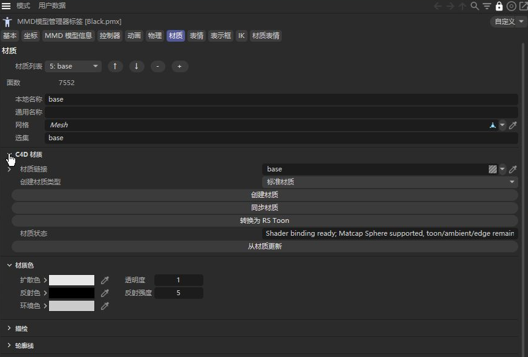

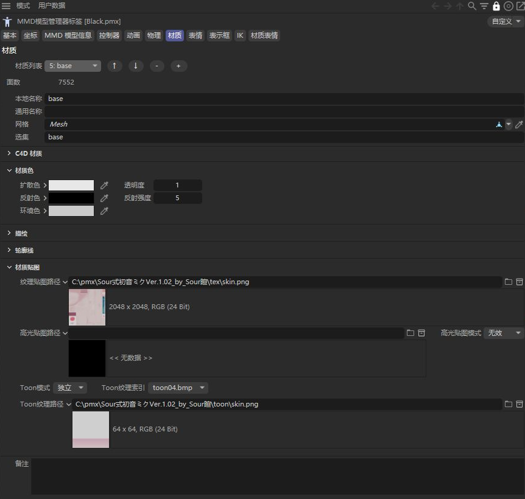

先在材质列表中选中一项。这些字段描述 PMX 材质数据及其与 C4D 材质的连接。

| 区域 | 含义与用法 |
| --- | --- |
| 列表、↑／↓、−／+ | 选择、排序、删除或添加 PMX 材质项。修改列表后应检查网格分配和面范围。 |
| 面数、名称、网格、选集 | 查看材质分配的面、本地／通用名称，以及 C4D 分配所用的网格和多边形选集。 |
| 材质链接 | 对应的 C4D 材质。变化没有作用到预期网格时，先核对这个链接。 |
| 创建材质类型／创建材质 | 从所选 PMX 材质创建标准、RedShift、Octane、Corona 或 RS Toon 材质。可用渲染器和受支持的转换路径取决于安装环境及 C4D 版本。 |
| 同步材质 | 将保存的 MMD 材质字段发送给链接的 C4D 材质。 |
| 从材质更新 | 从未受管理的 C4D 材质读取支持的字段到 PMX 基础数据。需处于编辑模式并关闭材质预览；受管理的表情着色输出没有独立的基础值可反向读取。 |
| 转换为 RS Toon／材质状态 | 将选中分配转换到支持的 MMD 风格 Redshift Toon 设置，并查看状态；需要 Redshift。 |
| 材质色 | 扩散色与透明度、反射色与强度、环境色。 |
| 描绘／轮廓线 | PMX 双面、阴影、顶点色标记，以及轮廓线开关、尺寸、颜色和透明度。保存的 PMX 标记不保证所有 C4D 渲染器显示完全相同。 |
| 材质贴图 | 基础纹理路径；高光／球面纹理路径及无效、乘算、加算、子纹理模式；独立或共用 Toon 纹理，含 toon01–toon10。 |
| 备注 | 所选 PMX 材质的说明。 |

##### 8. 表情

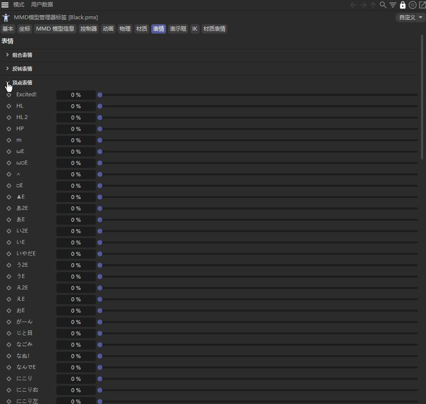

“表情”页按类型展示模型已有的强度控件：组合、翻转、顶点、UV、骨骼、材质和冲量。组合／翻转引用其他表情；顶点、UV、骨骼修改相应数据；材质表情修改材质字段；冲量作用于物理刚体。

用强度滑块制作姿势或动画；动画模式中，导入的 VMD 表情通道会驱动对应强度。“新建名称／添加”用于创建组合、翻转、材质或冲量条目，不会自动生成顶点或 UV 形变。展开条目可编辑该类型提供的字段。材质表情的实际偏移在独立的“材质表情”页编辑。

##### 9. 表示框（Display Frame）

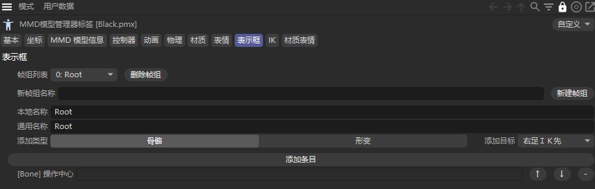

这里的“框”是 **PMX 的骨骼／表情显示分组**，不是时间轴帧。在“帧组列表”中选择现有项，或填写“新帧组名称”后新建；编辑本地／通用名称，选择骨骼或表情作为添加类型，再选目标并添加条目。已有条目可编辑或移除，“删除帧组”删除选中分组。分组用于组织 PMX 控制列表并保留到导出，不负责动画打帧或隐藏网格。

##### 10. IK

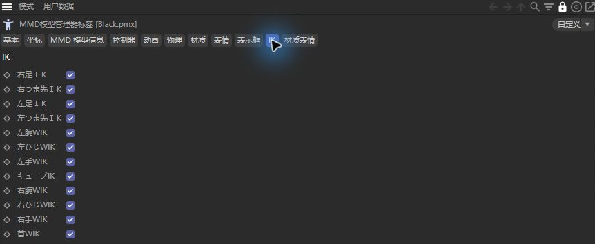

“IK”页按导入骨架列出可用求解器，每个开关控制一条 IK 链。VMD 模型信息通道可以驱动这些开关，因此设置可能随动画槽或帧变化。脚或手的目标没有带动姿势时，应核对这里的开关、四肢控制模式及模型的 IK 骨骼定义。关闭单条 IK 链与关闭整个模型的物理用途不同。

##### 11. 材质表情

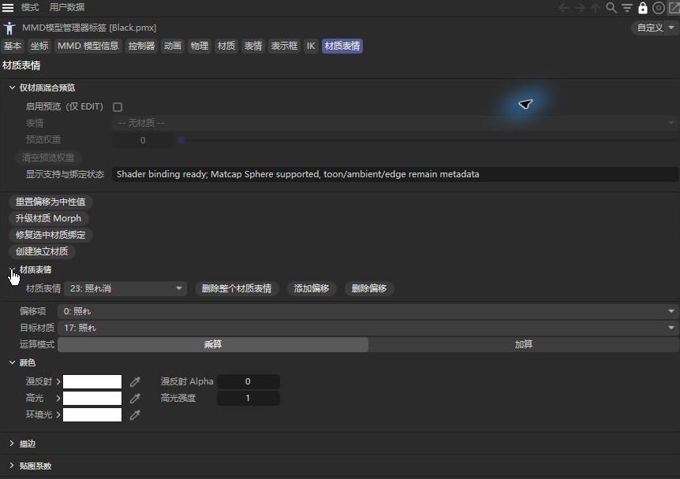

“表情”页控制强度，“材质表情”页编辑强度所应用的数据。先选表情，再选偏移项，然后修改字段。

| 控件 | 含义与用法 |
| --- | --- |
| 材质表情／删除整个表情 | 选择材质表情或删除完整条目，完整删除需处于编辑模式。 |
| 添加／删除偏移、偏移项 | 管理当前表情的各条材质修改记录。 |
| 目标材质 | 选择一个 PMX 材质或全部材质。 |
| 运算模式 | 乘算或加算。乘算各分量的中性值为 1，加算为 0；“重置偏移为中性”按当前模式初始化所选记录。 |
| 颜色／描边／贴图系数 | 修改漫反射及 Alpha、高光及强度、环境光、描边颜色／Alpha／尺寸，以及基础、球面、Toon 贴图系数。渲染器可能只显示部分字段，应查看状态。 |
| 启用预览（仅编辑）、表情、预览强度 | 在编辑模式中预览材质变化，不生成动画关键帧。每个预览表情的强度分别保留，可混合预览多个效果；组合／翻转仅在适合纯材质预览时列出。 |
| 清除预览强度 | 清除临时混合预览强度。进入动画模式也会清除该预览。 |
| 升级材质表情 | 在编辑模式中为支持的材质表情工作流准备受管理的材质绑定。 |
| 修复选中绑定 | 在编辑模式中修复所选材质的受管理绑定。 |
| 创建独立材质 | 在编辑模式中为所选材质创建独立绑定，适合避免共享材质影响其他模型。 |
| 显示支持／绑定状态 | 效果缺失或意外作用到其他模型时，查看渲染器支持情况及绑定诊断。 |

PMX 导出保存所编辑的材质与表情数据；某个 C4D 渲染器是否支持预览，不决定偏移是否存在于 PMX 中。从 C4D 材质更新基础数据前应清除预览；修改偏移后，再切到动画模式检查表情动画。

图中的 **23: 照れ消** 作用于 **17: 照れ**，使用乘算，漫反射 Alpha 为 0。表情强度为 1 时，它会让这项材质变为透明；这里的乘数不是材质本身的基础透明度。检查时，先进入编辑模式，启用预览，选择该表情，再将预览权重从 0 调到 1。若没有显示效果，应检查绑定状态，并在支持的材质上升级绑定。检查完成后清除预览权重，再继续常规编辑。

#### VMD 动作适配 · 体型调整与分阶段对比

把为一个角色制作的 VMD 调整到另一个角色：按来源与目标 PMX 的骨架比例修正移动，按需启用姿态、扭转、手臂避让、手腕／手指接触、落地和腿部自碰撞避让。支持角色队列与相机适配，计算核心位于 [libMMD](https://github.com/AiMiDi/libMMD) 的 `libmmd::sizing`，不依赖 C4D SDK 或 Python 运行时。

1. 在“扩展”菜单找到 **MMD Tools - VMD 动作适配**。
2. 选择动作原本使用的**来源 PMX**，将已经导入场景的**目标 MMD 模型管理器**拖入模型框。
3. 选择 VMD 文件，或使用目标模型已有的 VMD 动画槽。模型与动作导入须使用相同倍率，例如示例均为 **8.5**。
4. 先检查比例／偏移结果，再按需开启高级约束。“手腕／手指接触”保留来源动作中相近手部标志点的相对关系，不会自动生成抓握或手指弯曲；“腿部自碰撞避让”有限度地移动足 IK 目标。
5. 点击计算，查看 C4D 状态栏进度；长计算可取消。通过阶段选择和时间轴回放原始、比例、偏移、姿态、扭转、避让与接触结果，支持并排／叠加对比和修改参数后自动刷新。
6. 检查残差与关键动作后，**应用为新动画槽**或导出 VMD。原动作槽保留。

##### 面板与输入设置

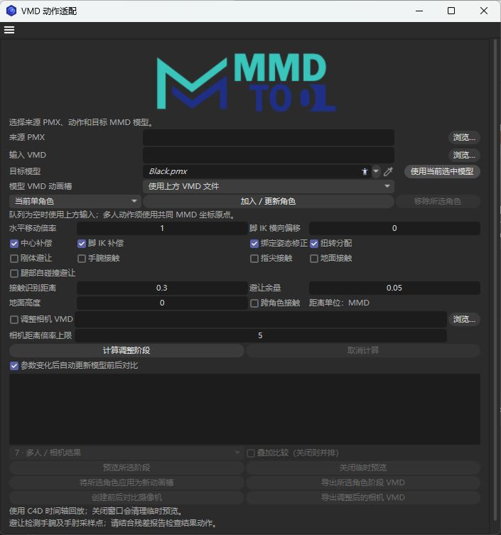

界面于 2026-10-13 在中文版 Cinema 4D 2026.4.0 中采集，目标模型为 Sour暄制作的 Sour式初音ミク Ver.1.02（Black.pmx）。截图处于输入准备状态：尚未选择来源 PMX 与动作，因此阶段预览和输出按钮不可用。下方视口对比图为此前单独采集的求解效果示例。

| 输入／队列控件 | 含义与操作 |
| --- | --- |
| 来源 PMX／浏览 | 选择动作原本针对的模型，用其绑定骨架计算来源比例。再次选择目标 PMX，并不能表达原角色的体型。 |
| 输入 VMD／模型 VMD 动画槽 | 可以使用文件，也可以选择目标模型已有的动作槽。“使用上方 VMD 文件”表示读取文件输入；来源槽被删除后，应重新选择有效槽。 |
| 目标模型／使用当前选中模型 | 拖入导入后的 MMD 模型根对象，或在原场景选中根对象后点击取用按钮；不要选择单个网格或骨骼。 |
| 当前单角色／加入或更新角色 | 空队列直接处理当前输入。多人时，为每个目标分别填写来源、动作和参数，再加入／更新队列。选择已有角色会恢复其设置。 |
| 移除角色 | 移除选中的队列项。新角色草稿须先加入队列才参与计算；最多支持同一文档的 16 个不同目标，要求倍率、MMD 坐标系与时间轴一致。 |

##### 比例与约束参数

先使用默认的比例／偏移、绑定姿态和扭转设置，检查结果后再开启其他约束。全部勾选不一定得到更好的姿势。

| 参数 | 作用与使用建议 |
| --- | --- |
| 水平移动倍率 | 在来源／目标比例分析基础上附加水平移动倍率，默认 1。用于调整运动距离，不会缩放模型网格。 |
| 腿 IK 横向偏移／中心补偿／脚 IK 补偿 | 设置附加腿 IK 横向偏移，并控制中心与脚 IK 的补偿。先分别查看比例、偏移阶段，确定额外位移从哪里产生。 |
| 绑定姿态修正 | 补偿受支持的肩臂和躯干绑定轴差异，不修改目标模型保存的绑定姿势。 |
| 扭转分配 | 在受支持的扭转骨链上分配旋转，开启后重点检查手腕与肘部方向。 |
| 刚体避让／避让余量 | 根据支持的 PMX 刚体形状调整手腕／肘部目标，余量用于设置间隔，不保证网格层面完全无穿插。 |
| 手腕接触／手指接触／接触识别距离 | 保留来源动作中相近手部标志点的关系；阈值决定哪些邻近关系参与判断，不是抓握强度。 |
| 地面接触／地面高度 | 相对给定地面修正支持的手部／足部接触。高度使用 MMD 单位，应检查迈步、蹲伏与腾空姿势。 |
| 腿部自碰撞避让 | 有限度地调整足 IK 目标以减少腿部干涉，应检查膝盖和脚踝；深度交叉仍可能残留。 |
| 跨角色接触 | 对队列角色之间支持的手部接触一起处理，需要共用 MMD 空间与时间基准。 |
| 调整相机 VMD／相机距离倍率上限 | 开启取景适配、选择相机 VMD，并限制距离倍率，默认上限 5。角色动作与相机动作是两个独立输入。 |

距离参数使用 **MMD 单位**，不是缩放后的 C4D 视口单位。默认接触识别距离为 0.3、避让余量为 0.05、地面高度为 0；应结合来源动作与目标模型调整。

##### 计算、阶段检查与输出

| 控件 | 含义与操作 |
| --- | --- |
| 计算调整阶段／取消计算 | 启动求解或请求取消。使用结果前先看状态和诊断；取消不会把结果应用成新动画槽。 |
| 参数变化后自动更新模型前后对比 | 参数变化后重新计算，并更新临时对比场景。连续输入多项参数时可以先关闭，之后手动计算。 |
| 阶段选择 | 依次检查 0 原始、1 移动比例、2 中心／IK 偏移、3 绑定姿态、4 扭转分配、5 刚体避让、6 接触修正、7 多人／相机结果。可选阶段仅加入已启用的修正。 |
| 预览所选阶段／叠加比较 | 打开临时前后模型：蓝色播放原动作，橙色播放所选结果；不勾叠加时为并排。用 C4D 时间轴回放，重点看接触与过渡位置。预览关闭物理。 |
| 诊断区域 | 检查警告、最大残差和未解决约束。计算完成仍可能存在不可达或互相冲突的目标。 |
| 关闭临时预览 | 关闭对比文档。关闭工具也会移除临时预览；预览本身不等于已应用动画。 |
| 将所选角色应用为新动画槽 | 把选中角色的结果加入原场景模型的新动画槽，保留原动作，支持撤销／重做。目标绑定结构发生变化后应重新计算。 |
| 导出所选角色阶段 VMD | 导出当前选中的角色及阶段。多人队列时，写文件前尤其要核对这两项。 |
| 创建前后对比摄像机／导出调整后的相机 VMD | 将前后摄像机一起加入原场景，或将调整后的相机动作写入 VMD；需要有效的相机计算结果。 |

模型应使用标准 MMD 骨名，并检查缺失参考骨骼的警告。离线求解不包含场景控制器覆写、动态物理或外部父级。最后仍须在目标模型上检查关键姿势，必要时手工修正。

启用相机适配并选择相机 VMD 后，阶段预览会同时保留**蓝色的调整前摄像机**与**橙色的调整后摄像机**。切换阶段时保留当前查看的前／后摄像机；“创建前后对比摄像机”将两者一起加入源场景，可用一次撤销移除。调整前摄像机使用原始相机 VMD，便于对照构图；并排预览会随角色位置移动两组摄像机。对象管理器图标同样区分颜色（支持图标着色的 C4D 版本）。

模型为阿芙 2.0，动作为 Stay Tonight Heaven Lee Ver.。以下为 C4D 原生视口效果，物理关闭。

**腿部与整体姿态：左侧直接播放未经适配的原始 VMD，右侧为完整动作适配结果。** 两侧使用相同导入倍率、动作帧和视角。

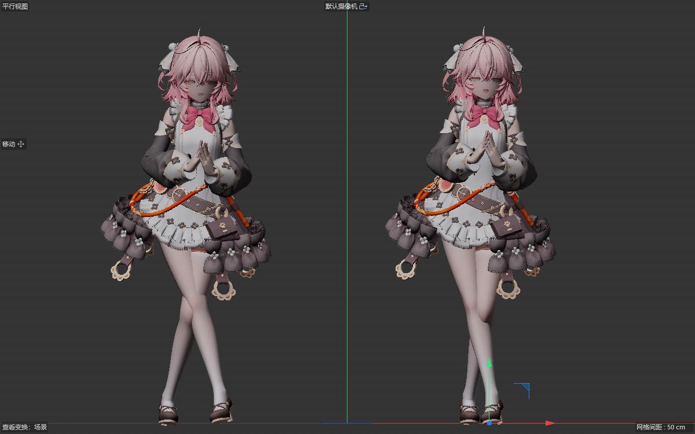

**手腕接触修正：左侧为旧接触求解结果，右侧为保留手部姿态后的修正结果。** 此图展示交叠手部的处理变化。

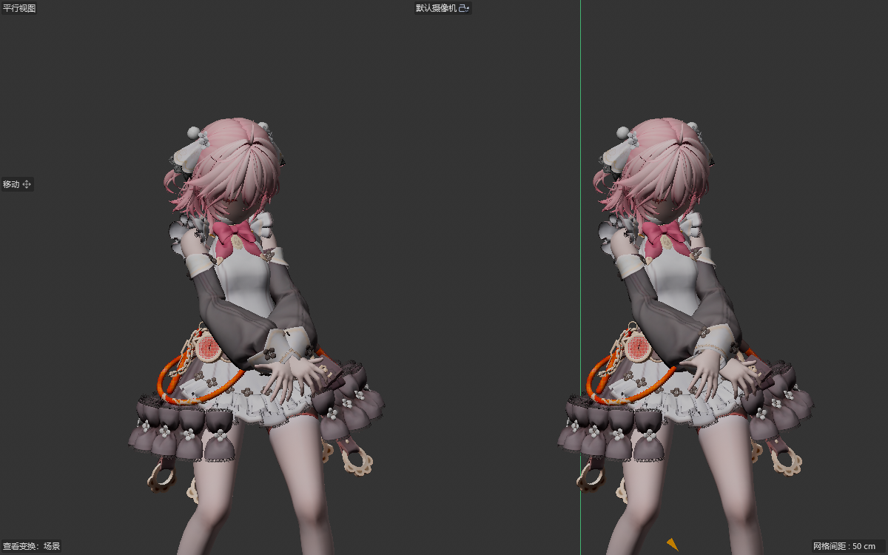

**当前范围：** 避让基于标准骨链与刚体形状，不保证网格级无穿插，也不替代完整物理模拟或足底锁定。深度交叉和互相冲突的目标仍可能需要手工调整，请结合分阶段预览检查关键姿势。

**参考项目：** 体型与移动补偿参考 [miu200521358/vmd_sizing](https://github.com/miu200521358/vmd_sizing)，依据版本 `e5c30358696f688c96544e3af33ea9871961487d` 移植相关公式；保留其 [MIT 许可及版权声明](res/S24_up/licenses/vmd_sizing-MIT.txt)。高级约束为本项目的 C++ 实现，不宣称与原 Python 工具全部功能或求解结果等价。

[完整使用说明与能力边界](docs/dev/vmd-sizing.md) · [MCP 调试接口](docs/dev/motion-sizing-mcp.md) · [真实素材验证](docs/validation/vmd-sizing/leg-ik-fix-20261010/README.md)

飞书文档: https://fsrjo99ngu.feishu.cn/docs/doccnjnPb8YuNmiVEheSzBj7bSd

## 开发者说明

**开发文档：** [DEVELOPMENT_zh.md](DEVELOPMENT_zh.md) · [English DEVELOPMENT.md](DEVELOPMENT.md)

**MCP 接入：** [客户端配置](docs/dev/mcp-client.md) · [实现与验收状态](docs/dev/mcp-support.md) · [2026-10-08 验收](docs/dev/mcp-acceptance-20261008.md)。当前工作树的 16 个生产工具与适配器已完成 Windows / C4D 2026.4+ 验收，包含普通 Release/桥 OFF 的真实调用、超时恢复与宿主重启。macOS 和旧宿主 UI 已明确延期并保留未验证；公开发行尚未验收。

### 开发者：CMake 构建（多 SDK）

- **基线**：日常使用根目录 `dev-windows` / `workflow-dev` 预设；直接构建 SDK 时使用各 `sdk_*` 中的预设。2026 SDK 工具链位于 `sdk_2026/cmake`；兼容 SDK 桥接使用 `cmake/sdk`。
- **依赖**：Bullet3 与 libMMD 通过 `cmake/mmdtool_plugin_dependencies.cmake`（`mmdtool_plugin_dependencies_add`）以 **CMake 子目录 + 目标链接** 并入各 `sdk_*` 工程，**无需**安装到 `dependency/install`。可选根工程：`cmake --preset dev-windows` 后 `cmake --build --preset cmt-deps-build`。libMMD 测试：预设 `dev-windows-deps-test` + `cmake --build --preset cmt-deps-test`，或 `-D CMT_DEPS_ENABLE_LIBMMD_TESTS=ON`。清理：`cmake --build _build_msvc --target cmt-clean-deps`（需已配置根工程；会删除各 `sdk_*` 在 `_build_msvc/<sdk名>/cmt_deps` 下的 Bullet/libMMD 构建树，以及根工程 `dependency/` 子项目产生的 `_build_msvc/cmt_deps`）。若要连插件目标一并清空，可用根目标的 `cmt-clean`。
- **仅生成某 SDK 的工程文件（Windows）**：`configure_sdk.bat sdk_2026 windows_vs2022_v143`（preset 可省略，默认 `windows_vs2022_v143`）。
- **根目录预设 `dev-windows`**：只生成仓库**根**工程 `_build_msvc`（含 `dependency/`、`cmt-workflow` 等），**不包含** `mmdtool` 目标。查看/调试插件请在仓库根下的 **`_build_msvc/<sdk名>/`**（在 `sdk_*` 里执行 preset 时同样输出到此路径）打开解决方案，或先执行 `cmake --build --preset workflow-dev` 生成该目录。
- **根目录一键工作流**（需先配置根工程一次）：
  1. `cmake -S . -B _build_msvc -G "Visual Studio 17 2022" -A x64`
  2. `cmake --build _build_msvc --target cmt-workflow`（依赖 + 配置 + 编译插件；可通过 `-D CMT_SDK_DIR=...` 等变量指向目标 `sdk_*`）
- **典型命令**（仅插件、在某一 `sdk_*` 内；构建树在**仓库根** `_build_msvc/<sdk名>/`）：
  1. `cd sdk_2026`（或目标 `sdk_r25`、`sdk_2024` 等）
  2. `cmake --preset windows_vs2022_v143`
  3. `cmake --build ..\_build_msvc\sdk_2026 --config Debug`（将 `sdk_2026` 换成当前目录名）
- **产物**：Debug 下插件一般在 `_build_msvc/sdk_2026/bin/Debug/plugins/mmdtool/`（相对仓库根；SDK 目录名随版本变化）。
- **Release 与测试**：`cmake --preset release-windows` 后 `cmake --build --preset workflow-release`；测试用 `dev-windows-deps-test` 配置后运行 `cmt-deps-test`、`cmt-plugin-tests`，benchmark 使用独立的 `cmt-deps-benchmark`。PR/main CI 编译最新 SDK，发布跑完整 SDK 矩阵；CI 不执行测试或 Benchmark。
- **运行资源**：产物中的 `res/` 是经过校验的真实副本，资源单独修改也会刷新。`CMT_RUNTIME_RESOURCE_CONFIG_POLICY=reset` 默认使用仓库配置；本地 `preserve` 可保留输出目录中的偏好。调试时正常启动 C4D，插件加载后再 attach，详见开发文档。
- **Windows 安装包（Inno）**：`cmake --preset package-windows` 后 `cmake --build --preset inno-installer`，自动构建八套 SDK 再出包。`setup/Common/installer_script.iss` 消费 `_build_msvc/<sdk>/bin/Release/plugins/mmdtool/` 中的二进制与完整 `res/`。S22/S24/S26 组件分别复用 sdk_r21 / sdk_r23 / sdk_r25 产物；自定义路径可传 `/DSdkBuildDir=...`、`/DSdkBinConfig=...`。

若模型导入时勾选多部分出现问题请不要勾选。

**如果安装了插件没有显示，请检查是否C4D安装的为最新小版本（如R21的是R21.207才行，R21.115不显示的升级就可以用）**

## 版本更新

以下列出最近版本的主要变化，完整历史见 [更新日志](CHANGELOG_zh.md)。

### 0.9.3.8 · 单角色动作适配并行优化（2026-10-13）

扭转分配、手臂避让和逐帧接触修正默认使用至多四个工作线程，按帧顺序合并结果，腿部与落地连续性修正仍顺序执行，保持动作结果一致。进度由协调线程统一发布，取消或异常后等待所有工作线程退出再释放资源。libMMD 内部采用 C++20，公开头文件继续兼容 C++17；MCP 提供 `worker_count` 用于单线程对比。原生效果对比在 Windows C4D 2026.4、8.5 场景倍率下完成。正式出包可复用源码一致、完整验证通过的 Build 产物，避免重复编译相同的 21 项 SDK／平台任务。

### 0.9.3.6 · 连续约束与摄像机对比（2026-10-12）

改善落地修正的跨帧释放和腿部／接触约束的连续性保护；修正批量接触的参与角色预算判断。新增蓝色的调整前 VMD 摄像机与橙色的调整后摄像机，可保持阶段切换时的当前摄像机角色，并一起创建、撤销。补全面板队列重开恢复与动画槽删除提示，防止旧 MCP 状态覆盖手工修改。同时修复 MCP 字段类型断言，并延迟预览文档销毁，确保关闭／释放调用安全返回。已完成 Windows C4D 2026.4 原生验证并合入 main，由 GitHub CI 编译发布包。

### 0.9.3.5 · 动作适配修正与控制器工作流（2026-10-10）

已通过联合原生验收、发布 CI 与包核验，正式发布 [v0.9.3.5](https://github.com/AiMiDi/C4D_MMD_Tool/releases/tag/v0.9.3.5)。[联合验证记录](docs/validation/vmd-sizing/joint-release-20261010/README.md)。

1. 修正手腕／手指接触对原动作的破坏，保留手指弯曲、手掌朝向及来源动作中的接触关系。
2. 离线姿态复用播放 IK 求解器，保持 PMX 链限制、迭代次数与 VMD IK 开关；跳过无法直接写入的驱动骨轨道。
3. 新增可选腿部自碰撞避让，保护脚 IK 目标跟随，并处理时间跳变及地面目标冲突。
4. 长计算增加 C4D 状态栏进度与取消反馈，MCP 与面板共享相关参数。
5. 补充动作适配使用说明、手腕／腿部效果对比，以及参考项目说明。
6. 修复 PMX 绑定快照误判、顶点未初始化和 QDEF 权重读写，并修正播放 IK 全局缓存更新的副作用。
7. 新增身体分组、部位独显、手臂 IK 和膝方向控制，以及保持当前姿势的 FK／IK 切换、控制器关键帧和撤销。
8. 缩小控制器轮廓，修正模型缩放重复放大手部目标的问题；刷新显示时保留动画输入。
9. 稳定近共线 IK 链的小角度计算，减少微小输入差异引起的膝部姿态跳变。

复杂接触仍需通过阶段预览检查。[验证与已知限制](docs/validation/vmd-sizing/leg-ik-fix-20261010/README.md)

### 0.9.3.3 · VMD 动作适配（2026-10-10）

1. 新增分阶段 VMD 动作适配，涵盖体型缩放、移动偏移、姿态与扭转调整、刚体形状避让、接触约束、多角色处理和相机适配。
2. 新增多语言 C4D 面板，支持选择场景模型、使用已有动作槽、分阶段前后对比、角色队列及应用／导出。
3. 新增正式 MCP 动作适配接口，支持异步任务、取消、预览、应用／导出及面板共享状态。
4. 将可复用计算下沉到 libMMD，使用 `libmmd::sizing` 命名空间，不依赖 C4D SDK，并提供公共接口、回归样本和求解能力边界说明。
5. 修复 R20 源码处理器、R21 标准库和 2026 以前 LinkBox API 的兼容问题；动作适配保留 SSE2 编译以维持已验证的数值基线。

### 0.9.3.2 · 控制器位置与悬停名称（2026-10-09）

1. 修复重新导入 PMX 后眼睛控制器位置错误；双眼轮廓对齐实际眼睛，保留原始旋转轴和模型缩放。
2. 鼠标悬停生成的控制器线框时显示骨骼名称，跟随当前本地／英文命名设置；隐藏控制器及关闭样条显示时不提示。
3. 去掉圆环和椭圆上的方向三角形，保留肩部引线、手部线框盒和脚尖 IK 三角轮廓。
4. 编辑模式隐藏生成控制器，动画模式恢复主要／全部／隐藏设置；刷新时保留已有变换和动画轨道。
5. 修复 CI 拉取 Eigen 时受 GitLab 临时过载影响的问题：使用相同锁定提交的镜像，并加入有限重试。

[相对 0.9.3.0 的变更](https://github.com/AiMiDi/C4D_MMD_Tool/compare/v0.9.3.0...v0.9.3.2) · [验证范围](docs/dev/controllers-eye-hover-20261009.md)

## 作者

AiMiDi

   

讨论群：790973593
